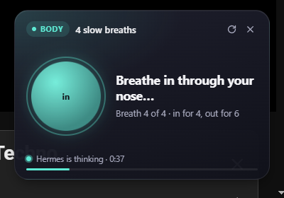
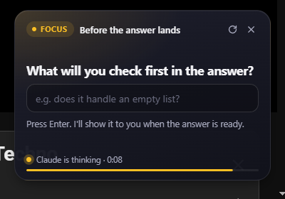
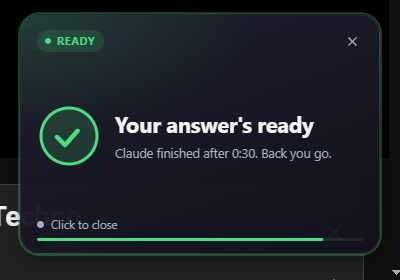

# Meanwhile ···

**Something to do while your AI thinks.**

You send a prompt. The agent needs a minute or two. You open a new tab "just for a second" and come back twenty minutes later. Meanwhile fills that minute with something small and good for you, and **pulls you back the moment the answer is ready**.

- **Pops up by itself.** Claude Code and Codex hooks tell Meanwhile when a prompt goes out and when the answer lands. No polling, no screen reading.
- **Pulls you back.** When the agent finishes, the card flips to *"Your answer's ready"* for a couple of seconds and fades out. If you closed it, it comes back just for that.
- **Tiny and bounded.** A 360×240 card in a screen corner, always on top, no taskbar button, never takes keyboard focus on its own. Every activity is 60 seconds or less.
- **Local only.** No account, no telemetry, no network except a token-protected endpoint on `127.0.0.1`.
- **Free and open source** (MIT).

| While the agent thinks | Before the answer lands | When it's done |
|---|---|---|
|  |  |  |

<sub>Real screenshots from a Windows 10 desktop, triggered by Claude Code and Hermes hooks.</sub>

## Install

| OS | One line |
|---|---|
| **Windows 10/11** (PowerShell, no admin) | `irm https://github.com/maxjustships/meanwhile/releases/latest/download/install.ps1 \| iex` |
| **Linux** (X11 or Wayland, WebKitGTK 4.1) | `curl -fsSL https://github.com/maxjustships/meanwhile/releases/latest/download/install.sh \| sh` |
| **macOS 11+** (**beta, untested on real hardware**) | `curl -fsSL https://github.com/maxjustships/meanwhile/releases/latest/download/install.sh \| sh` |

The installers download the release archive, verify its SHA-256 against `SHA256SUMS`, and install without admin/root: Windows into `%LOCALAPPDATA%\Meanwhile` (plus a Start menu shortcut), Linux and macOS into `~/.local/bin`. If Claude Code (`~/.claude`) or Codex (`~/.codex`) is installed, the hooks are connected for you (see below), then the app starts and sits in the tray as three dots. Set `MEANWHILE_NO_HOOKS=1` before the command to skip the hook setup.

Uninstall: Windows `irm https://github.com/maxjustships/meanwhile/releases/latest/download/uninstall.ps1 | iex`, Linux/macOS `curl -fsSL https://github.com/maxjustships/meanwhile/releases/latest/download/install.sh | sh -s -- --uninstall`. Both remove only Meanwhile's own hooks and keep your settings.

> **The binaries are not code-signed** (signing costs money; this is a free project). Windows SmartScreen may say "unknown publisher": choose *More info → Run anyway*. On macOS the installer fetches the binary with `curl`, which does not add the quarantine flag. Read the source or build it yourself (see below).

Linux needs the WebKitGTK 4.1 runtime (`webkit2gtk-4.1` on Arch, `libwebkit2gtk-4.1-0` on Debian/Ubuntu) and, for the tray icon, `libayatana-appindicator`.

## What it shows

| | Activities |
|---|---|
| **Body** | a stretch with an animated figure (neck, reach, shoulders, side bend, twist), drink water, the 20-20-20 eye break, 4 slow breaths |
| **Brain** | 45-second mental math sprint, a reaction/aim test, an English vocabulary flashcard |
| **Focus** | *"What will you check first in the answer?"* One line, and it is shown back to you when the answer is ready |

They rotate randomly. While the agent is still thinking, the next one starts by itself. Open it by hand (hotkey or tray click) and you get one activity, then *Close / One more*.

## Use

- **Hotkey:** `Ctrl+Alt+Space` toggles the overlay. Change it in *tray → Settings*.
- **Esc** or the × closes it. The ↻ button skips to something else.
- **Tray menu:** show/hide now, auto pop-up on/off, which activity types, which corner, start with the OS, settings, quit.
- **Quick answers don't flash.** The overlay waits 5 seconds after a prompt before it appears (configurable). If the agent answers sooner, you see nothing.
- An agent that gets interrupted never says "done", so Meanwhile stops waiting after 15 minutes.

## Connect your agent

The installer does this when it finds the agent. You can also click *Connect* in *tray → Settings*, or run it yourself:

```sh
meanwhile-hook setup claude     # ~/.claude/settings.json  UserPromptSubmit -> start, Stop -> done,
                                #                          StopFailure + SessionEnd -> cancel
meanwhile-hook setup codex      # ~/.codex/hooks.json      UserPromptSubmit -> start, Stop -> done
meanwhile-hook setup codex --remove
```

Setup **merges**: your other hooks stay exactly where they are, Meanwhile's entries are appended, and a timestamped backup of the file is written next to it (`settings.json.bak-meanwhile-<time>`). Running it twice changes nothing. It refuses to touch a file that is not valid JSON.

What it adds (Claude Code, Windows path shown):

```json
"hooks": {
  "UserPromptSubmit": [{ "hooks": [{ "type": "command", "command": "C:/Users/you/AppData/Local/Meanwhile/meanwhile-hook.exe start --from claude", "timeout": 5 }] }],
  "Stop":             [{ "hooks": [{ "type": "command", "command": "C:/Users/you/AppData/Local/Meanwhile/meanwhile-hook.exe done --from claude", "timeout": 5 }] }],
  "StopFailure":      [{ "hooks": [{ "type": "command", "command": "C:/Users/you/AppData/Local/Meanwhile/meanwhile-hook.exe cancel --from claude", "timeout": 5 }] }],
  "SessionEnd":       [{ "hooks": [{ "type": "command", "command": "C:/Users/you/AppData/Local/Meanwhile/meanwhile-hook.exe cancel --from claude", "timeout": 5 }] }]
}
```

`cancel` only clears a pending wait (a turn that died on an API error, or a session you quit mid-answer). It never cuts the "ready" card short.

**Codex trusts hooks one by one.** New hooks stay inactive until you approve them once: `/hooks` in the Codex CLI (press `t` to trust), or *Review hooks* in the composer / *Settings → Hooks* in the Codex desktop app. Both the CLI and the desktop app read the same `~/.codex/hooks.json`.

**Hermes Agent:** `integrations/hermes/meanwhile` is a Hermes plugin that sends start/done at the beginning and end of each turn (default: Telegram turns only), over SSH to the desktop running Meanwhile (`MEANWHILE_SSH_HOST`) or over HTTP (`MEANWHILE_URL` + `MEANWHILE_TOKEN`). Copy it to `~/.hermes/plugins/` and run `hermes plugins enable meanwhile`. Settings are in the plugin's docstring.

**Anything else** (another agent, a build script, a long test run) can use the same two commands:

```sh
meanwhile-hook start --from myagent
meanwhile-hook done  --from myagent
meanwhile-hook status
```

`meanwhile-hook` is silent, never reads stdin, gives up after 0.8 s and always exits 0, so it cannot slow down or break an agent, even when the app is not running. Add `-v` to see what happened.

### The HTTP endpoint

The app listens on `127.0.0.1:47800` (`port` in the config). `POST /start`, `/done`, `/cancel`, `/toggle`, `/status` need `Authorization: Bearer <token>`; the token is generated on first run and stored in the config file. Requests that carry a browser `Origin` header are refused, so a web page cannot trigger it. `GET /health` is open and only returns the app name and version.

```sh
curl -X POST -H "Authorization: Bearer $TOKEN" -d '{"from":"script"}' http://127.0.0.1:47800/start
```

To trigger it from another machine (an agent on a server, for example), add your LAN/tailnet address to `extra_listen` and allow the port in your firewall. The token is still required. Over SSH you can also simply run `meanwhile-hook start` on the desktop machine.

## Config

Windows `%APPDATA%\Meanwhile\config.json`, Linux `~/.config/meanwhile/config.json`, macOS `~/Library/Application Support/Meanwhile/config.json`. Everything is editable from the tray; the file is for the rest.

```json
{
  "port": 47800,
  "token": "generated-on-first-run",
  "hotkey": "Ctrl+Alt+Space",
  "corner": "bottom-right",
  "activities": { "body": true, "brain": true, "focus": true },
  "auto_trigger": true,
  "start_delay_seconds": 5,
  "max_wait_minutes": 15,
  "autostart": true,
  "extra_listen": []
}
```

A log of hook calls is kept next to it (`meanwhile.log`, rotated at 256 KB), handy when you wonder whether a hook fired.

## Limitations

- **Windows:** tested on Windows 10 (22H2) with the Claude Code and Codex CLIs. The Codex desktop app reads the same `hooks.json`; Windows 11 should behave the same but was not tried.
- **Linux:** runs on Arch/Hyprland (smoke test). On Wayland the compositor decides where windows go and whether they stay on top, so the corner setting and always-on-top may be ignored; a window rule helps (Hyprland: `windowrule = float, pin, noborder, noshadow, title:^(Meanwhile)$`). The global hotkey needs X11/XWayland; on pure Wayland bind `meanwhile-hook toggle` in your compositor instead.
- **macOS: BETA, untested on real hardware.** Built by GitHub Actions on `macos-latest` (universal binary, ad-hoc signed) but nobody has run it on a Mac yet. It runs as a menu-bar app without a Dock icon.
- Several agents at once share one overlay: the first `done` shows "ready".
- Codex hooks need the one-time trust approval described above.

## Build from source

Rust (stable) and the [Tauri 2 prerequisites](https://v2.tauri.app/start/prerequisites/) for your OS. No Node, no bundler: the UI is plain HTML/CSS/JS in `ui/`.

```sh
cargo test -p meanwhile-core    # config + hook-merging tests
cargo build --release           # target/release/meanwhile and meanwhile-hook
```

Preview the overlay in a normal browser: open `ui/overlay.html?demo=math` (or `stretch`, `water`, `eyes`, `breathe`, `reaction`, `vocab`, `focus`, `ready&note=...`).

Layout: `app/` is the tray app (Tauri 2), `crates/hook` the CLI, `crates/core` shared config and the hook-merge logic, `ui/` the overlay and settings pages, `windows/` and `install.sh` the installers.

## License

MIT, see [LICENSE](LICENSE).
